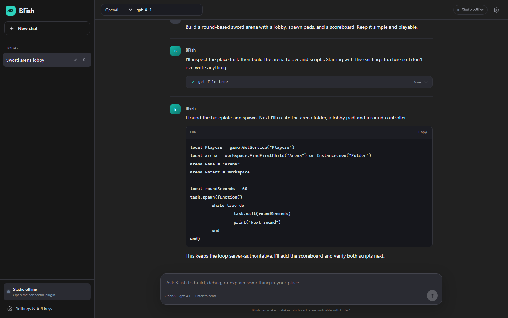

# BFish

**AI in Roblox Studio.** A local-first desktop AI engineer with a ChatGPT-style
workspace, seven model providers, and a Rust MCP server that can inspect and edit a
live place.

BFish is an independent open-source project. It is not affiliated with Roblox
Corporation.

```
┌──────────────────────────── BFish desktop app (Tauri) ────────────────────────────┐
│  Svelte chat UI  ── HTTP + SSE ──▶  bfish-backend  ──▶  provider APIs             │
│                                      │                                            │
│                                      ├── sessions, prompts, keys (local JSON)      │
│                                      └── bfish-mcp engine                         │
│                                              │                                    │
│                                     Studio bridge :34871                          │
└──────────────────────────────────────────────┼────────────────────────────────────┘
                                               │ localhost long-poll
                                    BFish Connector (Roblox plugin)
                                               │
                                        Roblox Studio
```

## What is in this repo

| Path | What it is |
| --- | --- |
| `crates/bfish-core` | Provider adapters (OpenAI, Claude, Gemini, DeepSeek, xAI, OpenRouter, Ollama), prompts, session storage |
| `crates/bfish-mcp` | Rust MCP server, Studio bridge, 23 tools, connector installer |
| `crates/bfish-backend` | Local API on `127.0.0.1:8765`, agent loop, SSE streaming |
| `crates/bfish-app` | Tauri v2 desktop shell |
| `app/` | Svelte 5 + Vite desktop UI |
| `plugin/` | Connector-only Roblox Studio plugin + `.rbxmx` builder |
| `website/` | Svelte + Vite landing page and docs |
| `docs/` | MCP, desktop, plugin, provider, architecture, and build docs |

## Features



- **Seven providers, one picker** — OpenAI, Claude, Gemini, DeepSeek, xAI, OpenRouter, and Ollama.
- **Live model detection** — asks each provider for its real model list and switches to a model your key can actually use.
- **Real Studio tools** — explorer reads, Luau execution, scripts, instances, assets,
  selections, playtests, console output, undo/redo.
- **Sessions** — saved local chats, rename/delete, auto titles, streaming responses.
- **Tool cards** — see every tool call, its arguments, and its result.
- **Connector-only plugin** — shows status and relays calls; no chat or keys in Studio.
- **Vendor-neutral MCP** — explicit schemas, structured errors, read-only/destructive hints.
- **Local-first** — keys and sessions never leave your machine except to your provider.
- **Undo-friendly** — mutations run inside Studio undo recordings.

## Quickstart

### Requirements

- Node.js 20+ and Rust 1.85+ for building
- Roblox Studio
- At least one provider key, or [Ollama](https://ollama.com) for local models

### Run the desktop app

The release executable bundles the UI and starts its own backend:

```powershell
scripts\run.ps1
# or after building:
target\release\bfish-app.exe
```

For desktop development:

```bash
cargo install tauri-cli --version "^2"
cd crates/bfish-app
cargo tauri dev
```

`cargo tauri dev` starts Vite and the backend automatically; don't run the backend
separately at the same time. `scripts\run.ps1` builds the standalone release
binary with the `custom-protocol` feature enabled.

### Browser development

```bash
cargo run -p bfish-backend
npm --prefix app run dev
# http://localhost:5173
```

### Connect Studio

```bash
cargo run -p bfish-mcp -- --install-plugin
```

Restart Studio, then open **BFish Connector** from the Plugins tab.

In the app: **Settings → Providers** add a key, then **Settings → Studio** confirms
the connection.

## bfish-mcp

The MCP server is a Rust fork of
[robloxstudio-mcp](https://github.com/Chrrxs/robloxstudio-mcp). It preserves the
upstream repository as the `upstream` git remote.

```bash
cargo install --path crates/bfish-mcp --locked
bfish-mcp --install-plugin
bfish-mcp --stdio          # MCP over stdio
bfish-mcp --http           # http://127.0.0.1:34871/mcp
```

Claude Desktop / Cursor / Cline config:

```json
{
  "mcpServers": {
    "bfish": {
      "command": "bfish-mcp",
      "args": ["--stdio"]
    }
  }
}
```

See [docs/mcp.md](docs/mcp.md) for the full tool reference and
[docs/architecture.md](docs/architecture.md) for internals.

## Development

```bash
cargo check -p bfish-core -p bfish-mcp -p bfish-backend
cargo test -p bfish-core -p bfish-mcp -p bfish-backend
node plugin/build.mjs
npm --prefix app run build
npm --prefix website run build
```

Useful scripts:

- `scripts/dev.ps1` — backend + Vite in two terminals
- `scripts/build.ps1` — release binaries, connector, UI, website
- `scripts/install-plugin.ps1` — install/update the Studio connector

## Configuration

| Variable | Purpose |
| --- | --- |
| `BFISH_HOME` | Override settings/session directory |
| `BFISH_PORT` | Backend port (default `8765`) |
| `BFISH_PLUGINS_DIR` | Override Roblox Plugins folder |
| `RUST_LOG` | Logging filter |

Default data locations:

- Windows: `%APPDATA%\BFish`
- macOS: `~/Library/Application Support/BFish`
- Linux: `~/.config/BFish`

Keys are stored unencrypted in `settings.json`. BFish is a local developer tool;
protect your user account accordingly. See [SECURITY.md](SECURITY.md).

## Current limitations (v0.1)

- No viewport screenshots, mouse/keyboard injection, or profiler capture yet.
- Playtest control depends on `StudioTestService` behavior in your Studio version.
- The connector owns one Studio window at a time; the bridge keeps up to four recent sessions.
- Only one process can own port `34871`.
- Tauri bundling is disabled by default; use `cargo tauri build` after configuring icons.

## Credits

- Protocol design and original tool surface:
  [Chrrxs/robloxstudio-mcp](https://github.com/Chrrxs/robloxstudio-mcp) (MIT).
- Built with [Tauri](https://tauri.app), [Svelte](https://svelte.dev),
  [Axum](https://github.com/tokio-rs/axum), and [Rojo](https://rojo.space) conventions.

Licensed under the MIT License. See [LICENSE](LICENSE).
